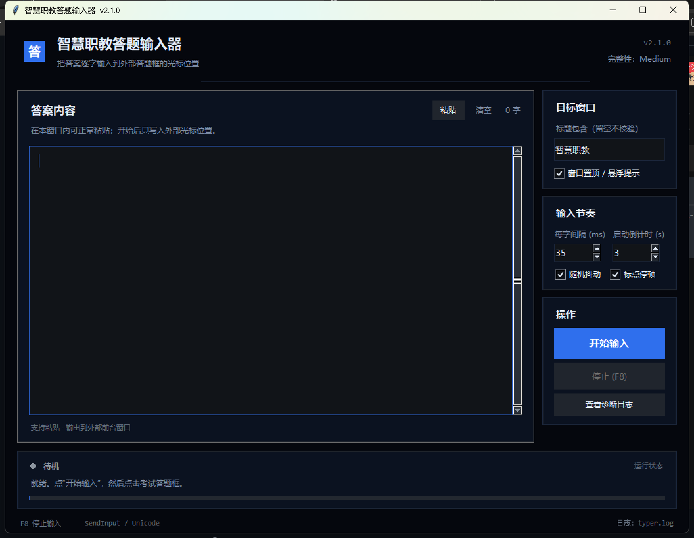

# 智慧职教答题输入器 v2.1  

一个独立的 Windows 工具：把答案粘贴到工具里，点击“开始输入”，工具隐藏主窗口并显示置顶提示条；你点击考试答题框、工具检测到外部焦点后倒计时 3 秒，再把文字**逐字符输入到外部窗口当前光标位置**。

不写剪贴板、不发送 `Ctrl+V`、不触发网页的 `paste` 事件。



---

## v2.1 界面重构

- 改成中性深色主题，去掉大面积霓虹青、英文大写标签和装饰性 HUD 元素。
- 左侧为答案编辑区，右侧为“目标窗口 / 输入节奏 / 操作”三块卡片，底部是运行状态与进度条。
- 使用更克制的蓝色强调色、深色滚动条、低对比边框，整体更接近真实桌面工具而不是演示面板。
- 保留 v2.0 的输入状态机、焦点检测、输入前销毁悬浮条、进程级自身焦点保护和低完整性修复。

## v2.0 重写内容

- **重写输入状态机**：待机 → 等待焦点 → 倒计时 → 输入中 → 完成/错误，按钮、状态标签、悬浮条、进度条统一由状态驱动。
- **重构面板布局**：左侧大答案编辑区，右侧独立的“输入设置 / 操作 / 运行状态”卡片，参数不再挤在一行。
- **修复低完整性导致完全无法输入**：从受限目录运行时 Windows 会以 Low Integrity 启动 EXE，UIPI 会拦截向浏览器/记事本发送输入。`start.bat` 会先把程序复制到 `%LOCALAPPDATA%\zhzj-typer-run` 再启动。
- **输入前销毁悬浮条**：避免悬浮条持有键盘焦点，出现“进度在走、外部窗口没字”的假输入。
- **进程级自身焦点保护**：按 PID 拒绝主窗口、悬浮条及其子窗口，不再只依赖标题。
- **先检测答题框焦点，再倒计时**：不需要在 3 秒内完成点击。
- **诊断日志**：记录启动、完整性、焦点窗口、倒计时、输入结果。

---

## 快速开始

### 推荐：双击 `start.bat`

`start.bat` 会先把 `zhzj-typer.exe` 复制到：

```text
%LOCALAPPDATA%\zhzj-typer-run\zhzj-typer.exe
```

再从这个目录启动。这样可以避免压缩包目录/受限目录的低完整性标签让 Windows 拦截输入。

> 如果直接双击 `zhzj-typer.exe`，请确保它位于普通可写目录（例如桌面上的独立文件夹）。如果标题栏右侧显示“完整性 Low”，输入会被 Windows 拦截，请改用 `start.bat`。

### 使用步骤

1. 双击 `start.bat`。
2. 把答案粘贴到左侧“答案内容”框。
3. 右侧设置：
   - **目标窗口标题包含**：默认 `智慧职教`；页面标题不含这四个字时清空。
   - **每字间隔**：默认 `35 ms`，编辑器慢可调 `50–80 ms`。
   - **启动倒计时**：默认 `3 秒`，是检测到答题框焦点后的倒计时。
   - **窗口置顶 / 悬浮倒计时**：默认开启。
4. 点击 **开始输入**。
5. 主窗口隐藏，右上角出现“请点击考试答题框”的置顶提示条。
6. 用鼠标点击考试答题框。检测到外部焦点后，提示条变成 3、2、1。
7. 文字逐字进入外部光标位置；按 **F8** 可随时中止。
8. 完成后主窗口自动恢复，检查答题框内容。

> 如果提示条一直显示“请点击考试答题框”，说明焦点还没有进入外部答题框。
>
> 如果提示条显示“标题不匹配”，清空“目标窗口标题包含”再重试。

## 仓库文件说明

| 文件 | 用途 |
| --- | --- |
| `zhzj-typer.exe` | 主程序（GUI） |
| `zhzj-typer-cli.exe` | 命令行版本，可脚本化调用 |
| `start.bat` | 推荐入口，复制到 `%LOCALAPPDATA%\zhzj-typer-run` 后启动，规避低完整性拦截 |
| `查看日志.bat` | 一键打印 `typer.log` 内容 |
| `inject_console.js` | 浏览器控制台备用方案，不依赖 exe |
| `sample_answer.txt` | 用于验证换行 / 中英混排的示例答案 |
| `shots/preview.png` | README 界面预览图 |

## 许可

本项目采用 [MIT](LICENSE) 协议。

### 作者：南京信息职业技术学院  一屿Yy
### 请尊重MIT开源协议